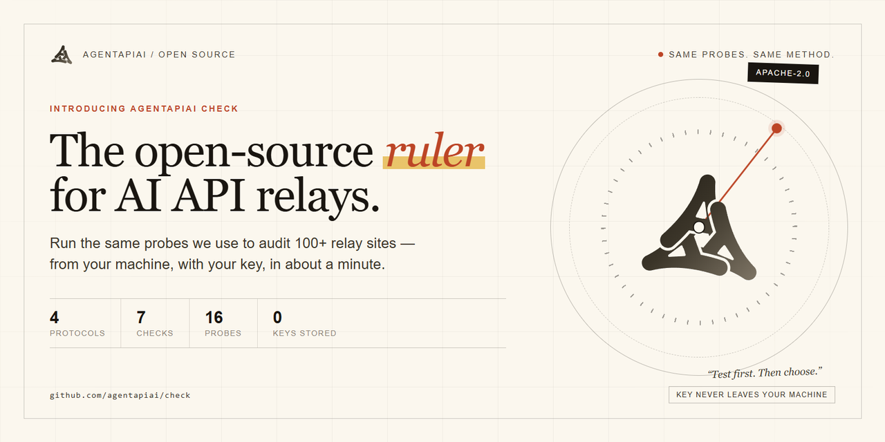
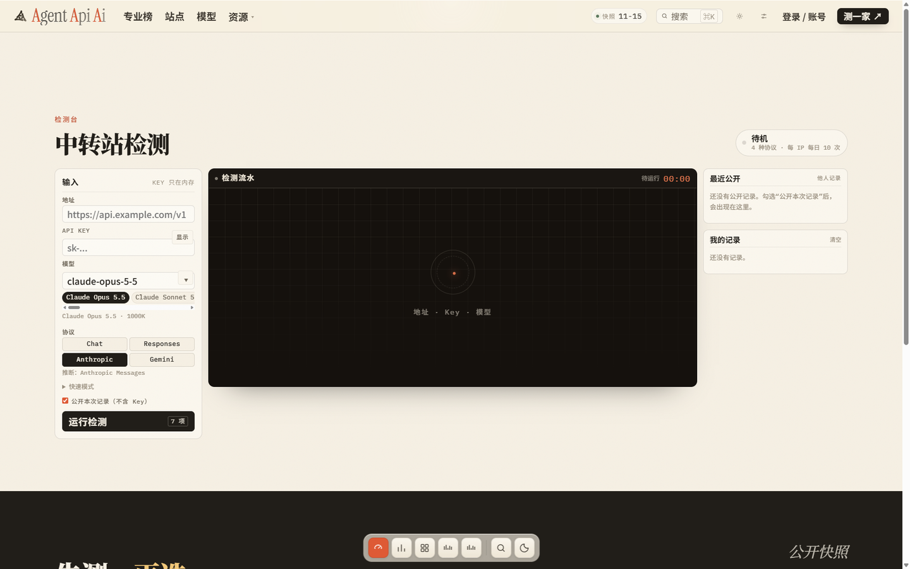
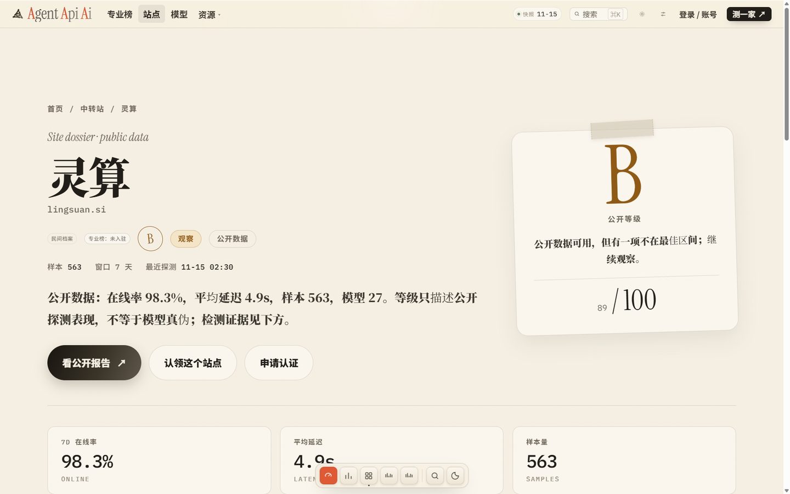

<div align="center">
  

  <h1>AgentApiAI Check</h1>

  <p><strong>The open-source ruler for AI API relays.</strong><br>
  Same probes. Same method. Every relay.</p>

  <p>
    <a href="LICENSE"></a>
    
    
    
    
    
    <a href="https://agentapiai.com"></a>
  </p>

  <p>
    <a href="#quick-start">Quick start</a> ·
    <a href="#what-it-checks">What it checks</a> ·
    <a href="#what-it-does-not-do">Limitations</a> ·
    <a href="#use-it-in-ci">CI</a> ·
    <a href="docs/methodology.md">Methodology</a> ·
    <a href="README.zh-CN.md">中文</a>
  </p>
</div>

---

AI API relay sites resell access to OpenAI, Claude, Gemini and other models. Some swap models, truncate context, or bill differently from what they claim. **AgentApiAI Check** runs the same probes we use to audit 100+ relay sites — from your machine, with your key, in about a minute.

- **4 protocols**: OpenAI Chat Completions, OpenAI Responses, Anthropic Messages, Gemini `generateContent`.
- **7 checks**: model authenticity, billing, context, error shapes, parameter adherence, tool calls, streaming.
- **16 probes** (15 active): small, documented, versioned.
- **Three-state verdicts**: `pass` / `suspect` / `fail`; `skip` means insufficient evidence, never a silent pass.
- **Your key never leaves your machine.** No upload, no storage, no server-side calls.

> **What this is not:** a legal proof of model identity, a leaderboard you can buy, or a claim of 100% accuracy. Read [what it does not do](#what-it-does-not-do) before you trust any number.

## Quick start

### Python (local detector)

```bash
python -m pip install agentapiai-check

export AGENTAPIAI_KEY="sk-..."   # keep the key out of shell history
```

> Alpha: until the first PyPI release, install from source instead:
> `python -m pip install "git+https://github.com/agentapiai/check"`

agentapiai-check verify \
  --base-url https://api.example.com/v1 \
  --model claude-sonnet-5-5 \
  --official-input-price 3 --official-output-price 15 \
  --claimed-context 200000
```

`--key` works too, but the environment variable is safer. The key is used to build request headers and is never written to disk or included in the report.

### Example output

```text
AgentApiAI Check · 2026-11-15T02:30:07+08:00
Target    api.example.com
Model     claude-sonnet-5-5
Protocol  anthropic
Family    claude
Probes    v1.0 (2026-11-13)

CHECK                 VERDICT   EVIDENCE
Model authenticity    pass      tokenizer fingerprint over 5 samples: 1.02–1.18 tokens/char
                                (family band 0.90–1.40)
Billing               suspect   response has no cost field (relay does not return total_cost)
                                → billing check uses the official-price baseline
Context               pass      needle at 45K chars → recovered
Error shapes          pass      error response HTTP 400, top-level keys ['error']
Parameter adherence   pass      max_tokens=16, completion_tokens=16, finish_reason=length
Tool calls            skip      anthropic tool-call format is not covered in v0.1; skipped
Streaming             pass      Content-Type=text/event-stream, 12 data chunks, first token 1.8s

Overall: suspect (4 pass, 1 suspect, 0 fail, 2 skip)
```

Example output is illustrative; verdicts depend on the endpoint and the moment you run it.

### Report formats and exit codes

```bash
agentapiai-check verify ... --format json       # machine-readable
agentapiai-check verify ... --format markdown   # GitHub Actions summary
agentapiai-check verify ... --output report.md --json-output report.json
```

| Exit | Meaning |
| --- | --- |
| `0` | overall `pass` |
| `1` | the run could not start (missing key, invalid arguments) |
| `2` | overall `suspect` |
| `3` | overall `fail` (or `suspect` with `--fail-on suspect`) |
| `4` | overall `skip` (insufficient evidence) |

## What it looks like

The tool is the CLI; the directory is the public data behind it.





<sub>Screenshots from agentapiai.com. Rows marked <code>样张</code> are sample data, not customer results.</sub>

## What it checks

| Check | What it proves | What it does **not** prove |
| --- | --- | --- |
| **Model authenticity** | Tokenizer fingerprint and metadata behavior are consistent with the claimed family across samples. | That the exact model version is genuine. A matching tokenizer is necessary, not sufficient. |
| **Billing** | `usage` fields and returned cost are consistent with the official price baseline within the configured tolerance. | That the provider's invoice is correct. It checks the API response, not the invoice. |
| **Context** | A needle placed at ~22.5% of the claimed context window is recoverable. | That the full window is usable under every prompt shape. |
| **Error shapes** | Invalid requests return the official family's error envelope and 4xx semantics. | That every error path is compliant; only the sampled paths are tested. |
| **Parameter adherence** | `max_tokens` is honored on the sampled request. | That all parameters are honored in all combinations. |
| **Tool calls** | A forced tool call returns a valid tool call payload. | Tool-call quality or multi-turn reliability. |
| **Streaming** | SSE framing is valid and TTFT is measured. | That streaming is never buffered upstream under load. |

Every item carries: timestamp (Asia/Shanghai), endpoint host, model, probe version, sample count, and a redacted evidence line. Missing evidence means `skip`, not `pass`.

Read [docs/methodology.md](docs/methodology.md) for the probe registry, the signature bands, and the decision rules.

## What it does not do

- **It does not declare a model "fake" with certainty.** Fingerprinting is probabilistic; a closed reference library can only say "most consistent with" or "outside the expected band".
- **It does not test prompt quality, safety, jailbreak resistance, or content policy.** Those are different products.
- **It does not test every route or every model.** You choose the endpoint and model; one run covers that route at that time.
- **It does not store or transmit your key.** Requests go directly from your machine to the endpoint you specify. Telemetry is off by default.
- **It does not rank relays or sell placements.** The public directory has a separate, disclosed methodology. This tool is the ruler, not the leaderboard.

See [docs/limitations.md](docs/limitations.md) for known false-positive and false-negative modes.

## Use it in CI

```yaml
name: relay-check
on: [deployment_status]

jobs:
  verify:
    runs-on: ubuntu-latest
    steps:
      - uses: agentapiai/check@v0.1.0
        with:
          base-url: ${{ secrets.RELAY_BASE_URL }}
          api-key: ${{ secrets.RELAY_API_KEY }}
          model: claude-sonnet-5-5
          claimed-context: "200000"
          official-input-price: "3"
          official-output-price: "15"
          fail-on: suspect
```

The action writes a Markdown summary to the job and a JSON report to `agentapiai-check.json`. Add `fail-on: suspect` if billing drift should block a deploy.

## Node directory client (read-only)

The Node package reads the public directory; it does not run the local detector. It is not on npm yet — run it from the repository:

```bash
node packages/node/bin/agentapiai.mjs sites --grade a --limit 10
node packages/node/bin/agentapiai.mjs stats
```

After the npm release, the same commands are available as `npx @agentapiai/check`.

## Use the public data

- `GET https://agentapiai.com/v1/sites` — site index
- `GET https://agentapiai.com/v1/stats` — dataset snapshot
- `GET https://agentapiai.com/v1/detect/latest?host=` — latest **published** verdict
- `https://agentapiai.com/data/sites.csv` — downloadable snapshot
- `https://agentapiai.com/mcp` — MCP endpoint for AI assistants

The dataset snapshot is licensed CC BY 4.0. Cite it as:

```text
agentapiai.com. AI API Relay Directory Snapshot.
Generated 2026-11-15T02:30:07+08:00. 108 sites, 38,644 samples, 7-day window.
https://agentapiai.com/data/sites.csv
```

## How it works

```text
your machine                         relay endpoint
     │                                    │
     ├── probe registry (versioned) ──────┤
     ├── 4 protocol adapters ─────────────┤
     ├── 7 checks ────────────────────────┤
     ├── evidence normalizer ─────────────┤
     └── report (JSON / Markdown) ────────┘
```

No control plane, no proxy, no key escrow. The CLI builds requests, sends them directly to the endpoint, and evaluates the responses locally. The probe registry is a JSON file with a version and date, so a report can be reproduced later.

## Security

- The key is read from `AGENTAPIAI_KEY` or `--key`, used in memory, and never logged.
- Reports include the endpoint **host**, not the full URL with credentials.
- Redirects are disabled, so a relay cannot bounce your key to another host.
- No telemetry. No analytics. No phone-home.

See [SECURITY.md](SECURITY.md) for reporting a vulnerability.

## Roadmap

- **v0.1** — 4 protocols, 7 checks, JSON/Markdown, GitHub Action, key never stored.
- **v0.2** — SARIF output, more probes, configurable budgets, English/Chinese report strings.
- **v0.3** — image and reasoning checks, history diffing, hosted report links (opt-in).
- **Later** — community probe registry, signed reports, CI templates for common providers.

Roadmap is discussed in [Discussions](https://github.com/agentapiai/check/discussions). No dates are promised.

## Contributing

- Read [CONTRIBUTING.md](CONTRIBUTING.md) and [CODE_OF_CONDUCT.md](CODE_OF_CONDUCT.md).
- Probes are data, not code: add a probe with a clear claim, a falsifiable check, and an expected failure mode.
- Security issues: see [SECURITY.md](SECURITY.md). Do not open a public issue for a key leak.
- By contributing you agree to the [CLA](CLA.md) (inbound = outbound plus a commercial relicense grant).

## License and trademark

- Code: [Apache-2.0](LICENSE).
- Public dataset snapshots: CC BY 4.0 with attribution.
- The name **AgentApiAI**, the logo, and the certification badge are trademarks of the project. Forks must use a different name and must not imply endorsement. See [TRADEMARK.md](TRADEMARK.md).

## Who builds this

Built by [agentapiai.com](https://agentapiai.com), an independent directory and testing project for AI API relay sites. We publish the method, the samples, and the failures. We do not sell rankings.

If this saved you from a bad relay, star the repo — it helps other developers find it.

---

<div align="center">
  <sub>Same probes. Same method. Every relay.</sub>
</div>
