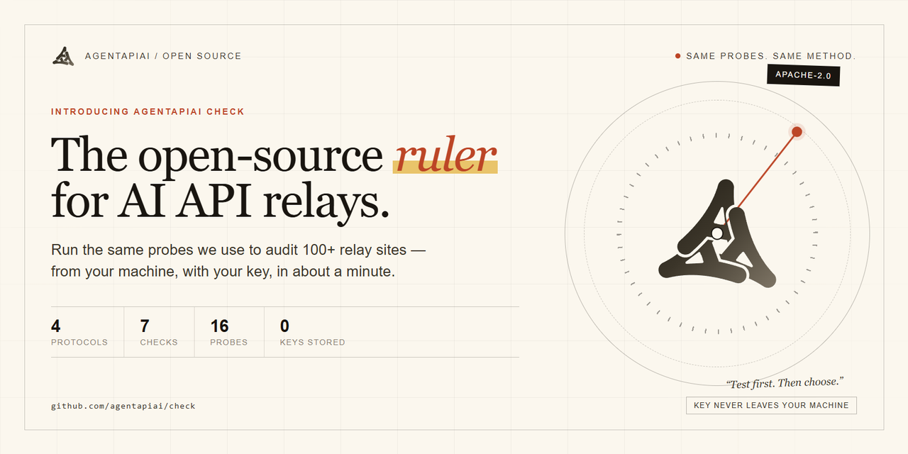
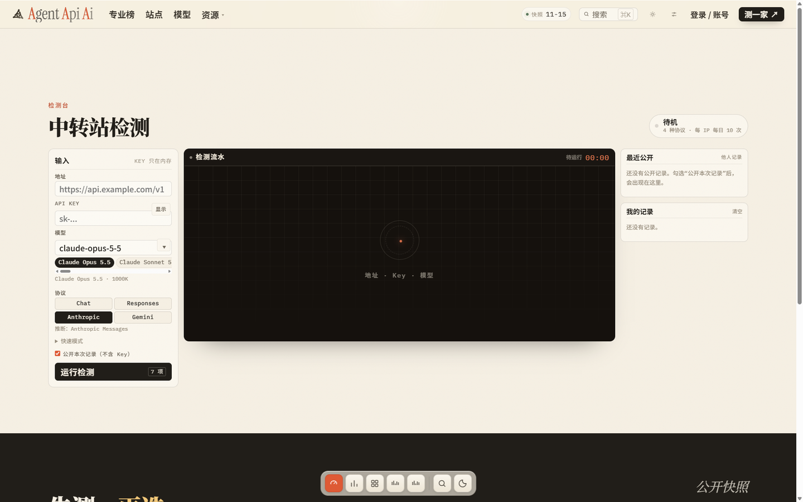
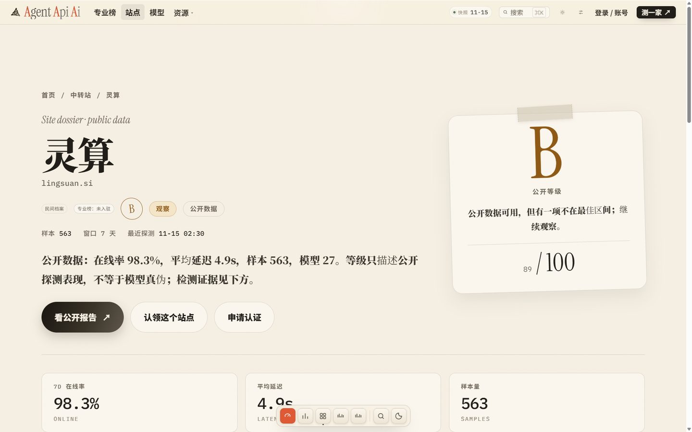

<div align="center">
  

  <h1>AgentApiAI Check</h1>

  <p><strong>把尺子开源：同一套探针，测给所有人看。</strong><br>
  4 种协议 · 7 项检测 · 16 个探针 · Key 不离开你的机器</p>

  <p>
    <a href="LICENSE"></a>
    
    
    
    
    
    <a href="https://agentapiai.com"></a>
  </p>

  <p>
    <a href="#快速开始">快速开始</a> ·
    <a href="#它测什么">它测什么</a> ·
    <a href="#它不测什么">它不测什么</a> ·
    <a href="#放进-ci">放进 CI</a> ·
    <a href="docs/methodology.md">方法</a> ·
    <a href="README.md">English</a>
  </p>
</div>

---

AI API 中转站转售 OpenAI、Claude、Gemini 等模型的访问权。有的会换模型、截断上下文、计费对不上。**AgentApiAI Check** 用我们审计 100+ 家中转站的同一套探针，在你自己的机器上、用你自己的 Key，大约一分钟跑完。

- **4 种协议**：OpenAI Chat Completions、OpenAI Responses、Anthropic Messages、Gemini `generateContent`。
- **7 项检测**：模型真假、扣费核对、上下文针刺、错误码合规、参数遵守、工具调用、流式输出。
- **16 个探针**（15 个启用）：小而透明，版本化。
- **三态结论**：`pass` / `suspect` / `fail`；`skip` 表示证据不足，绝不悄悄当成通过。
- **Key 不离开你的机器**：不上传、不落盘、不走服务端。

> **它不是：** 模型身份的法律鉴定、可以买的榜单、100% 准确的承诺。看任何数字之前，先读[它不测什么](#它不测什么)。

## 快速开始

### Python（本地检测器）

```bash
python -m pip install agentapiai-check

export AGENTAPIAI_KEY="sk-..."   # 不要把 Key 写进 shell 历史
```

> Alpha 阶段，PyPI 首发前请从源码安装：
> `python -m pip install "git+https://github.com/aragorn-agent/check"`

agentapiai-check verify \
  --base-url https://api.example.com/v1 \
  --model claude-sonnet-5-5 \
  --official-input-price 3 --official-output-price 15 \
  --claimed-context 200000
```

也支持 `--key`，但环境变量更安全。Key 只在内存里用于构造请求头，不落盘、不写日志、不进报告。

### 输出示例

```text
AgentApiAI Check · 2026-11-15T02:30:07+08:00
Target    api.example.com
Model     claude-sonnet-5-5
Protocol  anthropic
Family    claude
Probes    v1.0 (2026-11-13)

检测项                结论      证据
Model authenticity    pass      tokenizer fingerprint over 5 samples: 1.02–1.18 tokens/char
                                (family band 0.90–1.40)
Billing               suspect   response has no cost field (relay does not return total_cost)
                                → billing check uses the official-price baseline
Context               pass      needle at 45K chars → recovered
Error shapes          pass      error response HTTP 400, top-level keys ['error']
Parameter adherence   pass      max_tokens=16, completion_tokens=16, finish_reason=length
Tool calls            skip      anthropic tool-call format is not covered in v0.1; skipped
Streaming             pass      Content-Type=text/event-stream, 12 data chunks, first token 1.8s

Overall: suspect (4 pass, 1 suspect, 0 fail, 2 skip)
```

示例输出仅作说明；实际结论取决于端点和运行时刻。

### 报告格式与退出码

```bash
agentapiai-check verify ... --format json       # 机器可读
agentapiai-check verify ... --format markdown   # GitHub Actions 摘要
agentapiai-check verify ... --output report.md --json-output report.json
```

| 退出码 | 含义 |
| --- | --- |
| `0` | 总体 `pass` |
| `1` | 未能启动（缺 Key、参数错误） |
| `2` | 总体 `suspect` |
| `3` | 总体 `fail`（或 `--fail-on suspect` 时的 `suspect`） |
| `4` | 总体 `skip`（证据不足） |

## 它长什么样

工具是 CLI；目录是它背后的公开数据。





<sub>截图来自 agentapiai.com。标有 <code>样张</code> 的行是示例数据，不是客户结果。</sub>

## 它测什么

| 检测项 | 能证明 | **不能**证明 |
| --- | --- | --- |
| **模型真假** | 多次采样下，tokenizer 指纹与 metadata 行为与声称的模型家族一致。 | 具体模型版本一定是真的。tokenizer 一致是必要条件，不是充分条件。 |
| **扣费核对** | `usage` 字段与响应内计费字段，在设定容差内与官方价基准一致。 | 供应商的发票一定正确。它看的是 API 响应，不是账单。 |
| **上下文针刺** | 在声称上下文约 22.5% 处埋针，能回捞。 | 任何提示形态下整个窗口都可用。 |
| **错误码合规** | 非法请求返回官方家族的错误封套与 4xx 语义。 | 所有错误路径都合规；只测了采样路径。 |
| **参数遵守** | 采样请求里的 `max_tokens` 被遵守。 | 所有参数在所有组合下都被遵守。 |
| **工具调用** | 强制工具调用返回合法 payload。 | 工具调用质量或多轮可靠性。 |
| **流式输出** | SSE 分帧合法，并测出 TTFT。 | 高负载下上游从不缓冲。 |

每一项都带：检测时间（Asia/Shanghai）、端点主机、模型、探针版本、样本量、脱敏证据。拿不出证据就是 `skip`，不是通过。

完整规则见 [docs/methodology.md](docs/methodology.md)。

## 它不测什么

- **不会断言某个模型“一定是假的”。** 指纹是概率性的；闭集参考库只能给出“最像”或“超出预期带”。
- **不测提示词质量、安全性、越狱防护、内容策略。** 那是另外的产品。
- **不测所有线路、所有模型。** 你选端点和模型；一次运行只覆盖那条线路在那个时刻的表现。
- **不存储、不上传你的 Key。** 请求从你的机器直接发到你指定的端点；遥测默认关闭。
- **不排名、不卖位置。** 公开目录有单独且披露的方法。这个工具是尺子，不是榜。

完整清单（含已知误判/漏判模式）见 [docs/limitations.md](docs/limitations.md)。

## 放进 CI

```yaml
name: relay-check
on: [deployment_status]

jobs:
  verify:
    runs-on: ubuntu-latest
    steps:
      - uses: aragorn-agent/check@v0.1.0
        with:
          base-url: ${{ secrets.RELAY_BASE_URL }}
          api-key: ${{ secrets.RELAY_API_KEY }}
          model: claude-sonnet-5-5
          claimed-context: "200000"
          official-input-price: "3"
          official-output-price: "15"
          fail-on: suspect
```

Action 会把 Markdown 摘要写进 job，把 JSON 报告写到 `agentapiai-check.json`。如果计费偏差要阻断发布，用 `fail-on: suspect`。

## Node 目录客户端（只读）

Node 包读取公开目录，不运行本地检测。尚未发布到 npm，先从仓库运行：

```bash
node packages/node/bin/agentapiai.mjs sites --grade a --limit 10
node packages/node/bin/agentapiai.mjs stats
```

npm 发布后，同样的命令可用 `npx agentapiai-check`。

## 使用公开数据

- `GET https://agentapiai.com/v1/sites` — 站点索引
- `GET https://agentapiai.com/v1/stats` — 数据快照
- `GET https://agentapiai.com/v1/detect/latest?host=` — 最近一份**已发布**结论
- `https://agentapiai.com/data/sites.csv` — 可下载快照
- `https://agentapiai.com/mcp` — AI 助手的 MCP 端点

数据快照采用 CC BY 4.0。引用格式：

```text
agentapiai.com. AI API Relay Directory Snapshot.
Generated 2026-11-15T02:30:07+08:00. 108 sites, 38,644 samples, 7-day window.
https://agentapiai.com/data/sites.csv
```

## 它怎么工作

```text
你的机器                              中转站端点
    │                                     │
    ├── 探针注册表（版本化）──────────────┤
    ├── 4 个协议适配器 ──────────────────┤
    ├── 7 项检测 ────────────────────────┤
    ├── 证据归一化 ──────────────────────┤
    └── 报告（JSON / Markdown）──────────┘
```

没有控制面、没有代理、没有 Key 托管。CLI 构造请求，直接发给你指定的端点，在本地评估响应。探针注册表是带版本和日期的 JSON 文件，所以报告以后还能复现。

## 安全

- Key 从 `AGENTAPIAI_KEY` 或 `--key` 读入，只在内存中使用，不写日志。
- 报告只写端点**主机名**，不写带凭证的完整 URL。
- 禁用重定向，中转站不能把你的 Key 弹到别的主机。
- 没有遥测、没有统计、没有回传。

漏洞报告见 [SECURITY.md](SECURITY.md)。

## 路线图

- **v0.1** — 4 协议、7 检测、JSON/Markdown、GitHub Action、Key 不落盘。
- **v0.2** — SARIF 输出、更多探针、可配置预算、中英文报告字符串。
- **v0.3** — 图片与推理检测、历史对比、托管报告链接（需显式同意）。
- **以后** — 社区探针注册表、签名报告、常见供应商 CI 模板。

路线图在 [Discussions](https://github.com/aragorn-agent/check/discussions) 讨论，不承诺日期。

## 参与贡献

- 先读 [CONTRIBUTING.md](CONTRIBUTING.md) 和 [CODE_OF_CONDUCT.md](CODE_OF_CONDUCT.md)。
- 探针是数据，不是代码：新增探针要写清“主张什么、怎么证伪、失败模式是什么”。
- 安全问题看 [SECURITY.md](SECURITY.md)；Key 泄露不要开公开 issue。
- 提交即同意 [CLA](CLA.md)（inbound = outbound，并授予商业再许可）。

## 许可证与商标

- 代码：[Apache-2.0](LICENSE)。
- 公开数据快照：CC BY 4.0，需署名。
- **AgentApiAI** 名称、Logo、认证徽章是项目商标。Fork 必须改名，不得暗示官方背书。见 [TRADEMARK.md](TRADEMARK.md)。

## 谁在做

由 [agentapiai.com](https://agentapiai.com) 构建——一个独立的 AI API 中转站目录与检测项目。我们公开方法、样本和失败项；我们不卖排名。

如果它帮你避开了一个坑，给仓库点个 star——这能帮更多开发者找到它。

---

<div align="center">
  <sub>同一套探针，测给所有人看。</sub>
</div>
